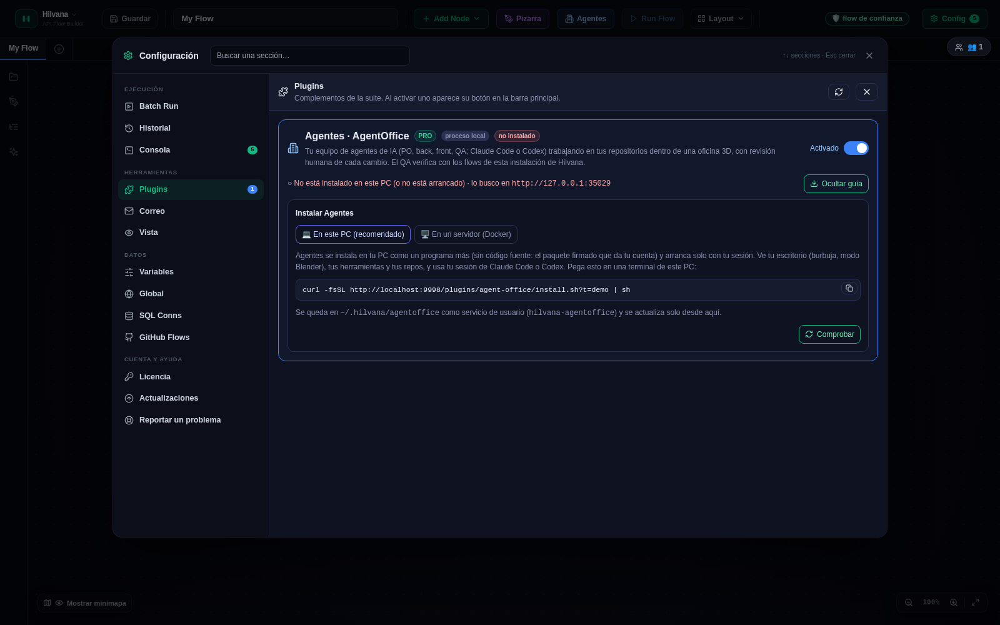
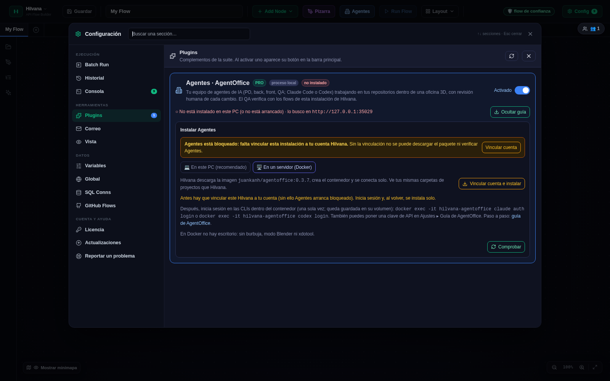
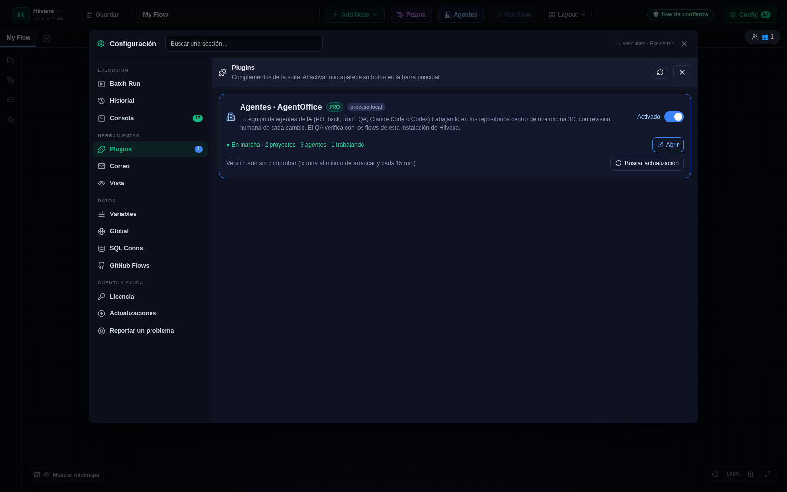
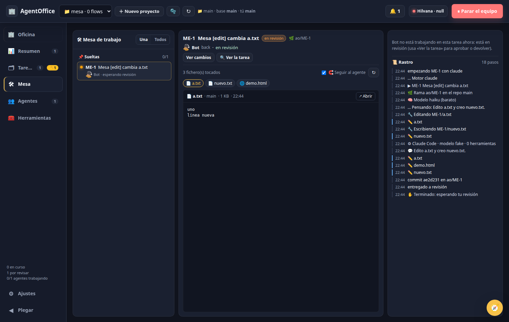
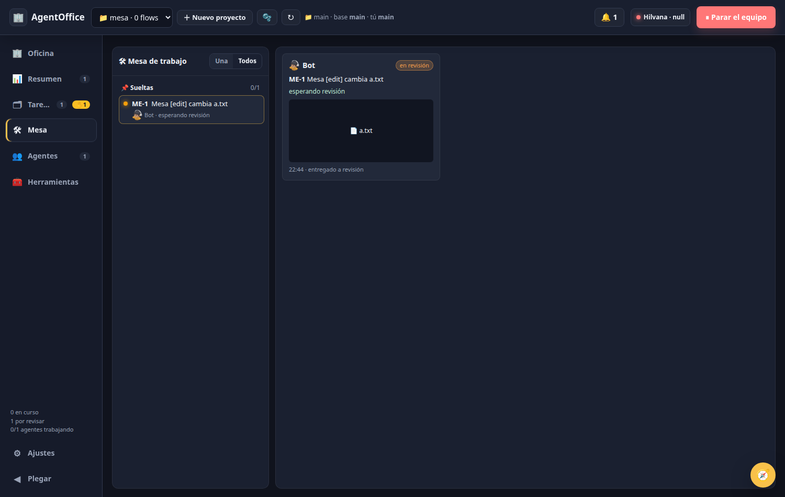
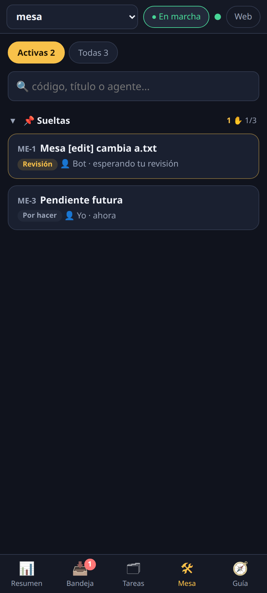
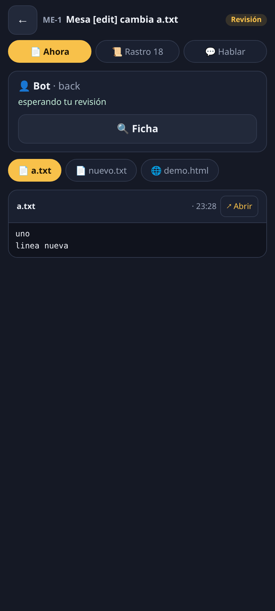

# 15 · AgentOffice — pantalla a pantalla (0.3.17)

> Revisado para Hilvana **6.4.0** · Manual de **AgentOffice 0.3.17**, tal como lo sirve Hilvana en `/agents/`. Las pantallas de la oficina son las de la 0.3.3; el texto de instalación y actualización es el de la 6.2.1; la **Mesa de trabajo** es de la 0.3.13 (filtro y buscador, 0.3.14; en el móvil, 0.3.15).

AgentOffice es la **oficina de agentes de IA** (Claude Code y Codex) de la suite: un equipo con roles que trabaja en tus repos, una **rama y una copia de trabajo (worktree) por tarea**, y **revisión humana** antes de fusionar. Corre aparte de Hilvana (puerto 7420). Desde la 6.2.0 se instala desde Config ▸ Plugins **en tu PC** (nativo, por defecto: una orden de terminal; servicio `hilvana-agentoffice` en `~/.hilvana/agentoffice`, con escritorio para la burbuja y el modo Blender) o **en un servidor** como contenedor `hilvana-agentoffice` de un clic (sin escritorio) y Hilvana lo sirve embebido en `/agents/` (escritorio) y `/agents/m.html` (móvil). Instalarlo y conectarlo: [nota 20 del manual](../agentoffice.md).

**Instalar desde Config ▸ Plugins.** Activa el plugin AgentOffice y pulsa **Instalar** en su tarjeta: la guía ofrece **💻 En este PC (recomendado)** —copias una orden `curl … | sh` y la pegas en una terminal de este PC (Linux)— o **🖥 En un servidor (Docker)** —botón **Instalar con un clic**, o el `docker run` para copiar si Hilvana no ve Docker—. Si este Hilvana aún no está vinculado a tu cuenta, el botón es **Vincular cuenta e instalar**: te lleva a Config ▸ Licencia y, al volver ya vinculado, la instalación en Docker continúa sola. Una vez «● En marcha», **Abrir** carga esta pantalla; AgentOffice se actualiza solo y la tarjeta avisa con «⬆ actualización». El detalle campo a campo está en el [capítulo 8 · Paneles](08-paneles.md).

## Mapa de la pantalla

Barra superior: **selector de proyecto**, **＋ Nuevo proyecto**, **🫧** (volver a mostrar las burbujas de los agentes), **↻** (comprobar que las carpetas de los proyectos existen), chip **🔔 Para ti** (tareas esperando tu revisión), chip de **cuota** (cuando una suscripción se acerca al límite), estado de **Hilvana** y **▶ Poner a trabajar / ⏸ Parar** el equipo del proyecto. Menú lateral: **Oficina, Resumen, Tareas, Agentes, Herramientas, Ajustes** y **Plegar** (reduce el menú a iconos). El botón redondo **🧭** abre la Guía (Ctrl+G).

## Oficina 3D

La vista inicial: el **edificio** (una planta por proyecto), la **planta** con sus zonas (Trabajo, Reuniones, Café, Recreo, Recepción, Kanban, despacho del PO) y cada **agente** en su mesa. Se navega Edificio ▸ Planta ▸ Agente (migas abajo); clic en un agente abre su cajón, clic en una planta entra en ella.

- **Burbujas de estado** sobre cada persona (icono + tarea + estado) y **paneles de información** en los márgenes: Progreso, Equipo, «Para ti», Consumo y cuota.
- Se ajusta en Ajustes ▸ **🎨 Oficina 3D**: paneles, personajes de ambiente (decorativos) y si las burbujas están siempre o «al pasar el ratón».
- En el móvil no hay escena 3D: la Oficina se sustituye por una lista de plantas.

## Resumen

Vista de **toda la empresa** de un vistazo: por proyecto, tareas por estado, agentes trabajando, gasto y avisos. Es la pestaña de entrada en el móvil.

## Tareas

El **tablero** tiene seis columnas: *Backlog · Por hacer · En curso · Revisión · Hecho · Descartada*. Cada tarjeta lleva código (`TD-1`), rol, agente previsto/asignado y estado. Arriba:

| Control | Qué hace |
|---|---|
| 🎯 **Objetivo para el PO** + **Encargar al PO** | Escribes (o dictas con 🎤) *qué* quieres; el PO (product owner) decide quién lo hace y **crea la tarea** — es la «creación con IA» de alto nivel. Enter encarga, Shift+Enter salta de línea |
| **＋ Tarea a mano** | Abre «Nueva tarea» (abajo) |
| **⏰ Programadas** | Plantillas de tareas automáticas (abajo) |
| **🔗 Conectar tablero…** | Enlaza GitHub, Trello o Jira (Ajustes ▸ Tablero online) |
| **Compacto / Detallado** | Densidad de las tarjetas |
| **👤 Mías** | Solo las asignadas a «Yo (humano)» |
| **🗄 Archivadas** | Muestra Hechas y Descartadas archivadas (no se borran nunca) |
| **🔍 filtrar…** | Filtro de texto |

Arrastrar una tarjeta de columna cambia su estado; el menú **⋯** de la tarjeta (y la ficha) permite editar, mover a otro proyecto (⇄, solo si no ha empezado), devolver, descartar…

### Nueva tarea: crear con IA, adjuntos y modos de desarrollo

- **Título** y **Descripción** (a mano, dictada con 🎤 o en bruto). **Para quién** (un rol, o **«PO»** para que reparta el trabajo), **Repositorio** (si el proyecto tiene varios), **Quién la hace** (automático por rol, un agente concreto o **👤 Yo**) y **Estado inicial** (Por hacer o Backlog).
- **✨ Redactar con IA**: pasa tu texto y los adjuntos por la IA (Claude), que propone título, descripción con criterios de «hecho cuando», rol y repo y **rellena el formulario** para que lo revises antes de crear. Puedes dejar el título vacío.
- **Adjuntos**: pegar o arrastrar ficheros e imágenes sobre el formulario. Las imágenes viajan como capturas de la tarea y los demás ficheros como archivos de apoyo. En el móvil los botones son **📷 cámara · 🖼 galería · 📎 fichero** (ver [Móvil](#móvil)).
- **🛠 Modo de desarrollo** (desplegable al final):

| Modo | Qué hace | Opciones |
|---|---|---|
| *(ninguno)* | Tarea normal | — |
| **web** | Abre la URL que el agente está construyendo en tu navegador y le pone su burbuja-chat | lado de la pantalla (izquierda/derecha), URL |
| **blender** | Abre Blender en su mitad de la pantalla con **4 vistas** (perspectiva, trasera, lateral, planta) y lo recarga y encuadra solo cada vez que el agente guarda el `.blend` | lado, fichero `.blend` (ruta relativa al repo), ejecutable en Ajustes ▸ «🧊 Ejecutable de Blender» |
| **🖥 Aplicación** | Abre **cualquier programa** (GIMP, LibreOffice, un editor…) en su mitad de la pantalla y el agente lo maneja por ti, con la misma burbuja-chat | lado, **qué abrir**: un fichero o URL (se abre con la aplicación asociada de tu sistema) o un comando (`gimp logo.xcf`, `libreoffice --calc`) |

**Modo «Aplicación»**

- La ventana nueva se coloca sola en la mitad de la pantalla del lado elegido (Linux con X11; en Wayland no se pueden mover ventanas ajenas y queda donde el sistema la ponga). Hay **una ventana por lado**: al empezar otra tarea en ese lado, se cierra la anterior. Se reabre si reinicias AgentOffice y se cierra al aprobar, devolver o borrar la tarea.
- Es **un modo de escritorio**: sin pantalla (servidor, contenedor) no abre nada. Si el programa no llega a abrir ventana, queda sin colocar.
- El agente recibe **herramientas de escritorio** solo en este modo: ver la ventana activa y la lista de ventanas, capturar la pantalla, leer y pulsar los controles de la aplicación, hacer clic, desplazar y escribir con el teclado. **Cada clic, tecla o pulsación de control te pide confirmación 🛡**, aunque tengas la Guía en ejecución automática; el clic o teclado «a ciegas» (sin controles localizables) además exige activarlo en Ajustes ▸ Guía. En los modos web y Blender, o sin modo, estas herramientas no existen.
- La **burbuja** es la misma de los demás modos (chat con su recuerdo, voz, capturas, boceto, aprobar o devolver, nueva ronda); su cabecera muestra la aplicación que maneja («Trabajando en gimp»).
- Ejemplo: tarea «Quita el fondo del logo» con modo Aplicación, lado derecho y `logo.xcf`. GIMP se abre a la derecha; el agente pide permiso 🛡 para cada acción, y desde la burbuja le escribes «hazlo más pequeño» o pulsas ↩ Devolver con tus comentarios.

**Las dos memorias.** Los agentes aprenden entre tareas con dos memorias que puedes leer y corregir:

- **Memoria del proyecto** (compartida por todo el equipo): Ajustes ▸ 📚 Memoria y contexto, o el apartado «De todo el proyecto» de la ficha de cualquier agente.
- **Memoria del agente** (solo suya, más su «Estado de mi trabajo»): en el cajón del agente ▸ 🧠 Memoria, campo «Suya». Una línea por lección; borra las que no valgan y pulsa **Guardar memoria**.
- **Promocionar**: en esa misma sección, una lección suya se puede subir a la memoria compartida para que la vean todos los agentes.
- Su historial de conversaciones sigue en 💬 Conversaciones.

### Programadas, comprobación sin IA y webhook

Por proyecto: una **plantilla de tarea** (título, descripción, rol, revisión obligatoria) que se crea sola **cada N minutos**, **cada día a una hora** o **cuando llega un aviso**. Opciones:

- **🔎 Comprobación sin IA**: una orden que corre en la carpeta del proyecto; código 0 = sin novedad (solo se apunta), **2 = crea la tarea** con la salida como datos, otro = error apuntado. Vigila sin gastar tokens.
- **🪝 Webhook** `POST /api/hooks/<token>` crea la tarea con el cuerpo del aviso (p. ej. el `notifyUrl` de un monitor de Hilvana). El token de la URL es la credencial.
- Botones por programada: ▶ ejecutar ahora, ✎ editar, pausar, ⇄ mover y ⧉ copiar a otro proyecto (la copia queda pausada y sin webhook). Si la tarea anterior sigue pendiente, esa vuelta se salta.

## Revisión: aprobar, devolver y «Llevar a mi checkout»

Al terminar, el agente deja la tarea en **Revisión** (columna naranja, chip **🔔 Para ti**, campana y avisos). Al abrir la ficha ves qué había que hacer, el resumen del agente y los botones:

| Botón | Efecto |
|---|---|
| **✓ Aprobar** | Fusiona la rama `ao/<código>` en la base (o, con «entregar sin commitear», solo cambia el estado). Si tu checkout tiene cambios locales los aparta con `git stash -u`, fusiona y los restaura |
| **↩ Devolver** | Le mandas lo que falta (texto, capturas, bocetos) y la tarea **vuelve a arrancar en su misma copia**; sube un peldaño la escalera de modelos |
| **Ver cambios** | Diff por repo y fichero, con ficheros nuevos |
| **✎ Editar** | Cambia título, descripción, rol, dependencias y modo de desarrollo |
| **📥 Llevar a mi checkout** | Aplica los cambios al checkout principal **sin commitear y sin mover HEAD** para verlos en tu IDE. Todo o nada: si tu checkout no está en la rama base o hay cambios en los mismos ficheros, no toca nada y te dice por qué |

**Política de revisión** (Ajustes ▸ ✅ Revisión y por proyecto): *Manual* (la revisas tú), *Auto-QA* (aprueba sola si el QA da el visto bueno) o *Auto*. Nunca se aprueban solas las tareas con «revisión obligatoria», cortadas por tope o atasco, que toquen ficheros sensibles o que el revisor haya devuelto dos veces.

## 🛠 Mesa de trabajo

La pestaña **Mesa** es el puesto de control de una épica: ves **en vivo** lo que hace cada agente, el fichero en el que está y su rastro paso a paso, y le hablas sin salir de ahí. Sirve igual para las tareas ya hechas (queda todo guardado).

- **Izquierda — la épica y sus tareas.** Las tareas del proyecto agrupadas por épica (el plan del PO y sus partes; el resto, «Sueltas»), cada una con su chip de estado, su agente y lo que está haciendo en ese momento. Por defecto se ven solo las **Activas** (en curso, en revisión, por hacer, backlog y fallidas); **Todas** añade el histórico de hechas y descartadas, y el buscador filtra por código, título o agente. Cada épica se pliega por su cabecera. Las tareas que van naciendo aparecen solas. Pulsa una para abrir su mesa.
- **Centro — la mesa de la tarea.** Cabecera con el estado, la rama y el agente, y los mismos mandos que en la ficha (⏸ Pausar, ✉ Mensaje, ⏹ Parar, 🫧 Burbuja si la tarea tiene modo de desarrollo, «Ver cambios», «🔍 Ver la tarea»). Debajo, los **ficheros que ha tocado** y el **artefacto vivo**: un plano SVG o una imagen se ven tal cual, un markdown o un csv maquetados, un PDF o un HTML en su marco, el resto como texto. Con **🧲 Seguir al agente** activo, la vista salta sola al último fichero que toca; elige un fichero a mano y se queda en él. **↗ Abrir** lo abre en una pestaña.
- **Derecha — hablarle y seguirle.** Sus **preguntas abiertas** (se responden ahí mismo), un **mensaje en caliente** mientras trabaja (o una restricción que se guarda en la tarea) y el **rastro**: cada paso con su hora, de la primera herramienta a la entrega: lo que piensa, lo que ejecuta, los ficheros que escribe, los avisos, tus mensajes y la revisión.

- **Todos**: una tarjeta por agente en marcha o en revisión, con lo que hace ahora, su último fichero en miniatura y su último paso. Pulsa una y entras en su mesa.
- Desde la ficha de cualquier tarea empezada, el botón **🛠 Mesa** te lleva a su mesa.
- **En el móvil** (pestaña 🛠 Mesa de la vista `/m` y de la app Android): la lista de tareas activas por épica con buscador, y al tocar una, su mesa a pantalla completa con tres pestañas: **📄 Ahora** (agente, lo que hace, ⏸ ■ y 🔍 Ficha, sus ficheros y el que está tocando: planos e imágenes a todo el ancho, textos maquetados), **📜 Rastro** (cada paso con hora, en vivo) y **💬 Hablar** (sus preguntas para responder ahí mismo y un mensaje en caliente, con dictado). El botón «atrás» del teléfono vuelve a la lista.

 
- Lo que ves está acotado al directorio de la tarea (su copia de trabajo, o la carpeta del proyecto si no hay repo): un fichero del agente nunca puede ejecutar nada en AgentOffice.

## 🖥 Modo «aplicación», burbuja única y dos memorias (0.3.16)

- **Modo aplicación.** Además de web y Blender, una tarea puede abrir **cualquier aplicación o fichero** en su mitad de la pantalla: pon un fichero o una URL (se abre con el programa por defecto) o un comando sin comillas de shell, por ejemplo `gimp logo.xcf`. La ventana nueva se coloca en el lado de la tarea. Se elige en **Nueva tarea ▸ 🖥 Aplicación…**. El agente de una tarea en este modo (y solo en este) puede además mirar y manejar el escritorio —ventana activa, clic, teclado, captura—, y cada acción te la pide a ti.
- **Burbuja idéntica en todos los modos.** La de aplicación es la misma burbuja-chat que la de web y Blender; en la cabecera aparece el nombre de la aplicación que se abrió.
- **Dos memorias visibles y editables.** En la ficha del agente ves y editas la **memoria compartida del proyecto** y la **propia del agente**. Una lección útil de la del agente se puede **promocionar a la compartida** para que la lean todos.

## 🔁 La revisión no se queda parada (0.3.17)

- Si AgentOffice se reinicia mientras una tarea estaba «en revisión», al arrancar **limpia esa marca y relanza la revisión** sola; antes la tarea quedaba bloqueada y arrastraba a las que dependían de ella.
- Si un agente entrega diciendo que **no ha hecho el trabajo** («no he empezado», «sin empezar»…), la tarea **vuelve una vez** a «Por hacer» con la orden de hacerlo en su rama; solo si lo repite se retiene para que decidas tú.
- Los agentes ya no esperan a otras tareas por su cuenta: las esperas las fija quien planifica en las dependencias de la tarea.

## Agentes y roles

La pestaña **Agentes** es la plantilla del proyecto: cada agente con su **rol** (PO, Back, Front, QA, coordinador…), motor (Claude/Codex/demo), modelo, estado y sus tareas. Desde aquí:

- **Contratar** un agente nuevo (nombre, rol, motor, modelo) o sacar uno del **banquillo** (agentes de la empresa sin proyecto); **despedir**.
- Abrir el **cajón del agente**: tareas, memoria, costes, MCP/skills/scripts propios; **⇄ Proyecto…** mueve el agente a otro equipo y **⧉ Copiar…** crea otro igual.
- **Roles**: definen el prompt base, el motor y las herramientas por defecto. Se editan, se crean propios y se comparten en el Marketplace.
- Debajo: **repos** del proyecto (base de las tareas, tu rama actual, agentes en cada uno) y la **🧠 Memoria de Claude Code del repo**.
- El **coordinador** del equipo reasigna tareas según puntuaciones, y el **supervisor de serie** vigila las tareas encadenadas.

## Herramientas: skills, MCP y scripts

Pestaña **🧰 Herramientas**, con tres subpestañas. Un aviso (insignia roja) indica herramientas que un rol o agente declara y que no llegan.

**🧩 Skills**: instrucciones reutilizables (ficheros `SKILL.md`) del catálogo (`<workspace>/_agentes`, o la carpeta fijada en Ajustes ▸ Conexión). Se asignan por rol o por agente y se publican en el Marketplace.

**🔌 MCP**: servidores MCP que los agentes pueden usar (navegador Playwright, Hilvana, bases de datos…). Se activan por rol/agente/tarea; el modo de desarrollo puede añadir los suyos.

**📜 Scripts**: órdenes del equipo que el agente ejecuta tal cual (y que el sistema le anuncia en el prompt), en vez de improvisar comandos.

## Ajustes sección a sección

El botón **⚙ Ajustes** abre un formulario único agrupado en **Empresa**, **Proyecto**, **Guía y voz** y **Seguridad**. Suelto aparece como diálogo con una sola lista; **dentro de Hilvana** (Config ▸ Agentes, o Ctrl+,) ocupa casi toda la ventana con un **menú lateral por grupos** que filtra y recorre con ↑/↓.

- **Barra Guardar siempre a la vista**: «Sin cambios» o «● N cambios sin guardar», con **Descartar** y **Guardar**; Guardar no cierra el panel.
- **Punto de cambios**: las secciones con cambios llevan un punto amarillo en el menú lateral. Si cierras (Esc, ✕, clic fuera) con cambios pendientes, pregunta antes. Un valor inválido en otra sección te lleva a ella y la marca.

### Grupo Empresa

| Sección | Captura | Para qué |
|---|---|---|
| 🧠 Motores de IA |  | Entrar con Claude (suscripción, Console o clave API), Codex (ChatGPT o clave) o una **IA local** (LM Studio/Ollama) |
| 🔌 Conexión con Hilvana |  | URL de Hilvana, carpeta del **catálogo**, carpeta del workspace en esta máquina |
| 👥 Equipo y capacidad |  | Agentes a la vez (máx.) y esfuerzo de los agentes |
| 💰 Costes y modelos |  | Tope de gasto/tokens por tarea, **escalera de modelos** (de barato a caro, sube al devolver), objetivo de costes, agrupar por caché, guardarraíl de cuota |
| ✅ Revisión |  | Política por defecto: manual / auto-QA / auto |
| 🧯 Atascos |  | Detecta agentes atascados (mismo comando, errores seguidos, pasos sin editar) y los pasa a Revisión |
| 📚 Memoria y contexto |  | Memoria de los agentes, memoria de Claude Code del repo, índice de código |
| 🎨 Oficina 3D |  | Paneles, personajes de ambiente y burbujas de la escena |
| 🧪 Experimentos |  | «Ponytail»: reglas de «construir lo mínimo» por rol |

### Grupo Proyecto

| Sección | Captura | Para qué |
|---|---|---|
| 📁 Proyecto |  | Carpeta del workspace y repos, prefijo de códigos, coordinador, **📂 acceso a la carpeta del proyecto** y **📤 entregar sin commitear** (ambas desactivadas por defecto), revisión por proyecto |
| 🔗 Tablero online |  | GitHub, Trello o Jira |
| 👁 Proyectos visibles |  | Ocultar proyectos de la UI (ocultar no para nada: un proyecto oculto en marcha sigue trabajando) |

### Grupo Guía y voz

| Sección | Captura | Para qué |
|---|---|---|
| 🧭 Guía |  | Motor y modelo del Guía, y el modo con el que nacen los chats nuevos (🧭 Guía o 🛠 Taller) |
| 🎤 Voz |  | Dictado: STT local o del navegador, **Probar micrófono** |
| 🔊 Voz del Guía |  | Proveedor y voz de lectura, **Probar voz** |

### Grupo Seguridad

| Sección | Captura | Para qué |
|---|---|---|
| 🛡 Qué puede hacer el Guía |  | Acciones que el Guía hace sin preguntarte |
| 🌐 Navegador de los agentes |  | Qué navegador usan los agentes (Playwright) y sus permisos |

## Burbuja del agente

Aparece junto al borde de la pantalla para los agentes que usan el navegador o trabajan en una tarea con **modo de desarrollo** (también hasta 12 h después de «hecha», para abrir una nueva ronda). Cabecera con el **nombre del proyecto**, el muñeco 3D del agente y la insignia de su motor (CLAUDE / CODEX).

- **Chat**: escribe (Enter envía) y pega o arrastra imágenes. Un agente Claude lo recibe **en caliente**; Codex lo recibe al relanzar la tarea (la burbuja lo avisa).
- **📸 Captura**: captura tu pantalla y la deja adjunta.
- **✏️ Boceto**: lienzo con lápiz, flecha, texto, goma y deshacer sobre la última imagen o en blanco; «Usar boceto» lo adjunta.
- **👍 Aprobar / ↩ Devolver**: cuando el agente termina muestra su resumen y estos dos botones, con las mismas reglas que la revisión del tablero.
- **Nueva ronda**: tras «hecha» la burbuja sigue 12 h; si le escribes abre una tarea nueva en el mismo hilo.
- **Plegar ▾**: queda solo el muñeco y se despliega sola si pregunta, te escribe o termina. **✕** oculta esa burbuja hasta que tenga novedades; **🫧** en la barra superior (o en Ajustes) vuelve a mostrarlas y reabre los Blender.
- Con dos agentes, cada uno en un lado de la pantalla.

## El recuerdo de cada agente: Conversaciones, Burbuja y «Que siga con…»

Cada agente conserva **su recuerdo**: todo lo hablado con él por la burbuja, tarea a tarea, se guarda y sobrevive a las tareas y a los reinicios. Lo ves de dos formas:

- **En la burbuja:** el hilo ya no es el de la tarea, sino el historial del agente, con un separador por tarea («— Tarea 21 —»). Al abrir una ronda nueva no empieza vacío.
- **En su ficha (Equipo ▸ tarjeta del agente ▸ 💬 Conversaciones):** el historial completo, con las imágenes que le mandaste, y un bloque **▶ Que siga con…**: eliges una de sus tareas anteriores (de cualquier proyecto), escribes qué quieres que haga a partir de ella y pulsas **Encargarle**. Se crea una tarea nueva para ese agente enlazada con la elegida, con su misma carpeta, modo de desarrollo y lado de pantalla, y su burbuja aparece al arrancar. Sirve para retomar algo meses después partiendo de lo que ya hizo y de lo hablado.
- **🫧 Burbuja** (en la misma tarjeta): abre su burbuja en pantalla aunque ahora no tenga tarea en curso, con su última tarea y su historial.

### Una sesión viva por agente

Antes, cada tarea abría una conversación nueva con el modelo y el agente volvía a leer todo el contexto. Ahora cada agente mantiene **una sesión viva**: su siguiente tarea retoma la misma conversación (mismo motor y modelo) con un encargo corto, así que recuerda lo anterior y el arranque cuesta mucho menos. La ficha del agente muestra la sesión (desde cuándo, cuántas tareas, tokens) y permite **reiniciarla**; en Ajustes se puede desactivar. Cuando la conversación crece demasiado, AgentOffice le pide las notas, las guarda en su memoria y abre una sesión limpia en la siguiente tarea. Codex no retoma sesiones: arranca con su memoria de agente.

### Un Blender por lado

En modo Blender, al arrancar una tarea nueva en un lado se cierra el Blender de la tarea anterior de ese lado y se abre el de la nueva, así nunca se apilan ventanas. Los entornos de prueba y de demo de AgentOffice no abren nada en tu escritorio.

## Telegram

AgentOffice puede hablar contigo por Telegram: te escribe los avisos y las preguntas del equipo, y tú le escribes para hablar con la Guía o lanzar comandos. Es opcional y se configura en **Ajustes ▸ 🔌 Integraciones**, con **tu propio** bot: nada pasa por servidores de terceros. **Sin captura**: la tarjeta pide un token real.

### Qué hace

- **Avisos y preguntas:** el bot te manda las preguntas de los agentes y las confirmaciones 🛡 con botones; pulsar uno contesta a la tarea, y responder al mensaje vale como respuesta escrita.
- **Hablar con la Guía:** cualquier texto que escribas al bot va a la Guía, con las mismas herramientas y confirmaciones que su chat en la aplicación.
- **☀️ Briefing diario:** a la hora que elijas recibes en Telegram las tareas que esperan tu revisión.

### Configurar Telegram paso a paso

1. En Telegram abre **@BotFather**, envía `/newbot`, elige nombre y usuario y copia el **token**.
2. Averigua tu **chat id** numérico (por ejemplo escribiendo a un bot como @userinfobot) y escribe un mensaje a tu bot para que pueda contestarte.
3. Ajustes ▸ 🔌 Integraciones ▸ tarjeta **Telegram**: pega el token, escribe tu chat id en **Chats autorizados**, marca **Activo** y **Guardar**; **Probar** envía un mensaje de comprobación.
4. Con la escucha en marcha aparece el chip **✈️** en la cabecera; al pulsarlo se abre esta tarjeta.

Solo se atienden los chats autorizados. El resto se ignora y queda anotado en la auditoría.

### Comandos y botones

| Comando | Qué hace |
|---|---|
| `/tarea <texto>` | Crea una tarea en el proyecto por defecto (o en el primero) para el rol de producto |
| `/parar` | Corta la conversación en curso con la Guía y detiene a los agentes que estén trabajando |
| `/ayuda` | Lista los comandos |

### Seguridad

- El token del bot se guarda en la carpeta de datos de AgentOffice, **no en el repositorio**. La pantalla y la API lo muestran enmascarado (`abc…xyz`): guardar el valor enmascarado o dejarlo vacío conserva el real.
- Límite de 20 mensajes por minuto y chat.
- **📋 Auditoría de acciones**: quién pidió cada acción, quién la confirmó y los chats ignorados.
- Para dejar de usar la integración: desmarcar **Activo**.

La conexión con el correo y la agenda de Google llegará en una versión próxima.

## Guía y Marketplace

La **🧭 Guía** (Ctrl+G, o el botón redondo) es un asistente con acceso a la app: crea tareas, mueve el tablero, consulta costes, abre flows de Hilvana, controla a los workers… Funciona como cajón lateral o a pantalla completa, con varios chats, adjuntos, dictado 🎤 y voz 🔊 (opcional, con «👂 escuchando» y palabra de activación). Qué puede hacer sin preguntarte se fija en Ajustes ▸ Seguridad.

**Dos modos por chat**, con el botón junto a la caja de texto (🧭 ↔ 🛠; se puede cambiar a mitad de conversación):

- **🧭 Guía**: conversa, supervisa, crea y revisa tareas, abre flows y navega. No ejecuta comandos ni edita ficheros. Es el modo de serie.
- **🛠 Taller**: el mismo asistente que tienes en tu editor (Claude Code completo) pero dentro de AgentOffice: trabaja en el repo del proyecto que estás viendo, con sus instrucciones y su memoria (la misma que en el editor, porque es la misma carpeta), puede ejecutar comandos, editar ficheros y usar tus conectores, y además ve el equipo de AgentOffice. Cada comando o edición te pide permiso con 🛡 (**Sí** · **Sí, siempre** · **No**); «Sí, siempre» se puede retirar en Ajustes ▸ Seguridad ▸ Permitidas siempre. Necesita Claude Code instalado en ese equipo. Ojo: en Taller se trabaja sobre tu copia real del repo, sin rama aparte ni revisión, igual que en el editor.

En **Resumen ▸ 💸 Costes**, el bloque «🧭 Guía vs 🛠 Taller» compara el gasto de los dos modos (chats, turnos, coste, $/turno, tokens, caché y herramientas por turno). Para comparar en igualdad, usa el mismo modelo en los dos y la misma petición en un chat de cada modo.

El **🛒 Marketplace** (botón dentro de Agentes) comparte **roles, skills y agentes** con tu organización o en público (con moderación) e instala los de otros. Pestañas: **Agentes · 🔒 Privado** (tu banquillo y tus roles) y las de la nube. *(En la captura sale un 404 porque el entorno de demo usa una instalación simulada de Hilvana sin cuenta vinculada: con la cuenta vinculada se ven los listados.)*

## ＋ Nuevo proyecto

Un proyecto de AgentOffice es una **carpeta del workspace de Hilvana** (donde viven sus flows y su documentación). El diálogo pide el nombre, la carpeta (existente o nueva) y los **repos** (rutas git que el equipo modifica; puede haber varios y cada tarea trabaja en su propio worktree por repo). También se admiten **proyectos sin repo**: solo carpeta. ↻ comprueba que las carpetas siguen existiendo.

## Ayuda en la app y asistentes

AgentOffice se explica solo: cada pantalla importante tiene su ayuda a mano y crear algo (agente, rol, proyecto, tarea) es una conversación guiada en vez de un formulario largo. Funciona igual en el ordenador y en el móvil.

**Botón ⓘ.** Junto a las pestañas, secciones de Ajustes y campos difíciles aparece un pequeño ⓘ.
- En el ordenador abre una burbuja junto al botón; en el móvil, una hoja desde abajo. Se cierra con ✕, con Esc, pulsando fuera o, en el móvil, con el botón «atrás».
- Cada ayuda trae un título, un texto breve y tres salidas: **📖 Ver en el manual** (abre esta misma sección del manual), **🧭 Pedir al Guía que lo haga por mí** (solo en las ayudas que el Guía puede ejecutar: le manda tu duda por su propio chat) y **↺ Volver a ver la guía de esta pantalla** (en las ayudas de pestaña).
- Ajustes ▸ Empresa guarda, solo en este navegador, un contador anónimo de las ayudas que has abierto (de la más a la menos consultada). No se envía a ningún sitio.
- Preguntas al Guía del estilo «¿qué es el modo Taller?» las responde con ese mismo catálogo de ayudas, con su enlace al manual.

**Guías de primer uso.** La primera vez que abres una pestaña (Oficina, Tareas…) un velo oscuro señala 3 o 4 elementos, uno a uno, con una frase cada uno («En “Tareas” encargas el trabajo…»). Avanza con **Siguiente**, el último paso dice **Entendido**; sal antes con **Saltar** o Esc; no vuelve a salir sola. Para repetirla: ⓘ de la pestaña ▸ **↺ Volver a ver la guía de esta pantalla**. En el móvil hay guías propias de cada pestaña. Si un elemento no está en pantalla, se salta ese paso.

**Asistentes de creación.** Cada uno hace preguntas llanas, valida antes de dejarte avanzar y tiene siempre el botón **Formulario completo** para volver al formulario de siempre (con lo ya escrito). Escape cierra el asistente; en el móvil, «atrás» retrocede un paso.
- **Contratar agente** (＋ Contratar): 3 pasos — qué quieres que haga, motor y modelo, y revisión antes de crear. Hay que ponerle nombre y elegir un rol que exista; si falta algo, el asistente te lo dice antes de seguir.
- **Nuevo rol**: preguntas llanas a la izquierda y el fichero del rol (`.md`) generándose en vivo a la derecha; parte de una plantilla y te deja cambiar herramientas, skills y el texto de instrucciones.
- **＋ Nuevo proyecto**: 6 pasos — Carpeta, Repositorios (una línea por repo: `clave = ruta @ roles`, `ruta @ roles` o solo `ruta`), Equipo, Motor, Revisión y Listo (con los primeros pasos a seguir, incluido **🎯 Encargar un objetivo** al PO).
- **Nueva tarea**: lo básico a la vista (título, descripción, adjuntos, **✨ Redactar con IA**) y lo avanzado plegado en **⚙ Avanzado** (para quién, repo, estado inicial, modo de desarrollo, MCP). Si la descripción es muy grande, avisa de que conviene dividirla; hay ejemplos para empezar.

**Estados vacíos.** Donde no hay nada todavía (equipo sin agentes, sin repositorios, nadie en el banquillo…) la pantalla lo dice y ofrece el botón para empezar (**＋ Contratar al primer agente**, **＋ Añadir repositorio**…) en vez de quedarse en blanco.

**Para el Guía.** El Guía puede consultar el mismo catálogo de ayudas (herramienta de solo lectura): sin indicar cuál, lista los temas; indicando uno (p. ej. la pestaña Tareas o la sección Equipo), te da su explicación y el enlace al manual.

**Errores típicos.** Si el ⓘ dice que no hay ayuda para esa pantalla, recarga la página (el catálogo no cargó). Si una guía de primer uso no sale, ya la viste: repítela desde el ⓘ de la pestaña.

## Móvil

`/agents/m.html` (y la app Android) es otra página, pensada para el pulgar: cabecera con proyecto, **▶/⏸**, indicador de conexión y enlace «Web», y cuatro pestañas abajo.

| Pestaña | Captura | Qué hay |
|---|---|---|
| 📊 Resumen |  | Estado de la empresa y **Equipo** del proyecto |
| 📥 Bandeja |  | «Para ti»: revisiones, preguntas y avisos (insignia con el número) |
| 🗂 Tareas |  | Filtros, tarjetas y **＋ Nueva tarea** |
| 🧭 Guía |  | Chat con la Guía: chats, ＋ Nuevo, 🎤 dictar |

**Hoja de Equipo**: tocar a una persona del Equipo abre su ficha (rol, motor, tarea actual, memoria…; lo que no tenga se oculta).

**＋ Nueva tarea** con adjuntos **📷 cámara · 🖼 galería · 📎 fichero** (se suben al elegirlos) y dictado:

