# 15 · AgentOffice — pantalla a pantalla (0.3.3)

> Manual de **AgentOffice 0.3.3**, tal como lo sirve Hilvana desde la **5.38.1** (al día en la **5.39.0**) en `/agents/`.

AgentOffice es la **oficina de agentes de IA** (Claude Code y Codex) de la suite: un equipo con roles que trabaja en tus repos, una **rama y una copia de trabajo (worktree) por tarea**, y **revisión humana** antes de fusionar. Corre aparte de Hilvana (puerto 7420) y Hilvana lo sirve embebido en `/agents/` (escritorio) y `/agents/m.html` (móvil). Instalarlo y conectarlo: [nota 20 del manual](../agentoffice.md).

## Mapa de la pantalla

Barra superior: **selector de proyecto**, **＋ Nuevo proyecto**, **🫧** (volver a mostrar las burbujas de los agentes), **↻** (comprobar que las carpetas de los proyectos existen), chip **🔔 Para ti** (tareas esperando tu revisión), chip de **cuota** (cuando una suscripción se acerca al límite), estado de **Hilvana** y **▶ Poner a trabajar / ⏸ Parar** el equipo del proyecto. Menú lateral: **Oficina, Resumen, Tareas, Agentes, Herramientas, Ajustes** y **Plegar** (reduce el menú a iconos). El botón redondo **🧭** abre la Guía (Ctrl+G).

## Oficina 3D

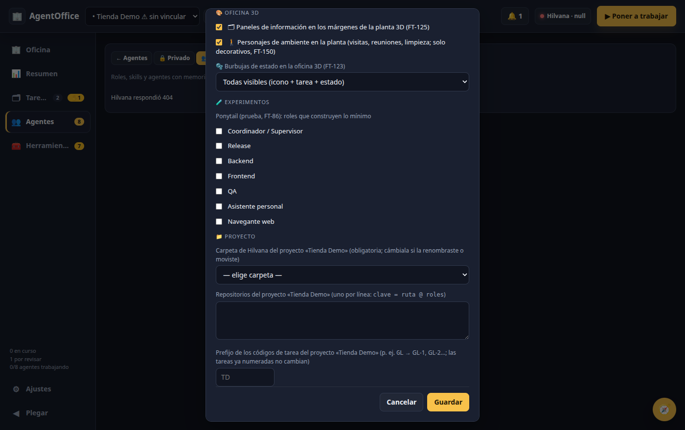

La vista inicial: el **edificio** (una planta por proyecto), la **planta** con sus zonas (Trabajo, Reuniones, Café, Recreo, Recepción, Kanban, despacho del PO) y cada **agente** en su mesa. Se navega Edificio ▸ Planta ▸ Agente (migas abajo); clic en un agente abre su cajón, clic en una planta entra en ella.

- **Burbujas de estado** sobre cada persona (icono + tarea + estado) y **paneles de información** en los márgenes: Progreso, Equipo, «Para ti», Consumo y cuota.
- Se ajusta en Ajustes ▸ **🎨 Oficina 3D**: paneles, personajes de ambiente (decorativos) y si las burbujas están siempre o «al pasar el ratón».
- En el móvil no hay escena 3D: la Oficina se sustituye por una lista de plantas.

## Resumen

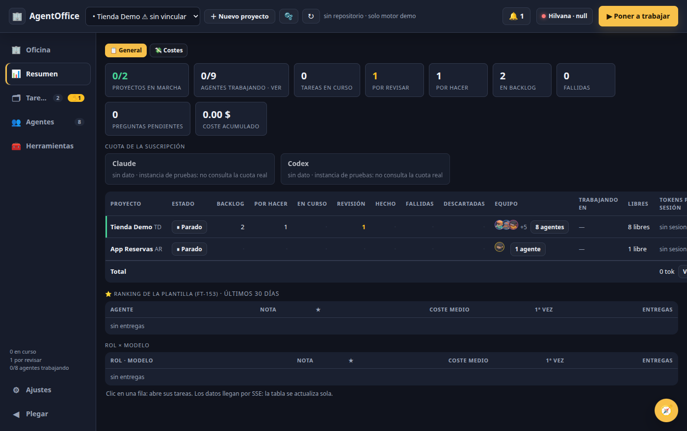

Vista de **toda la empresa** de un vistazo: por proyecto, tareas por estado, agentes trabajando, gasto y avisos. Es la pestaña de entrada en el móvil.

## Tareas

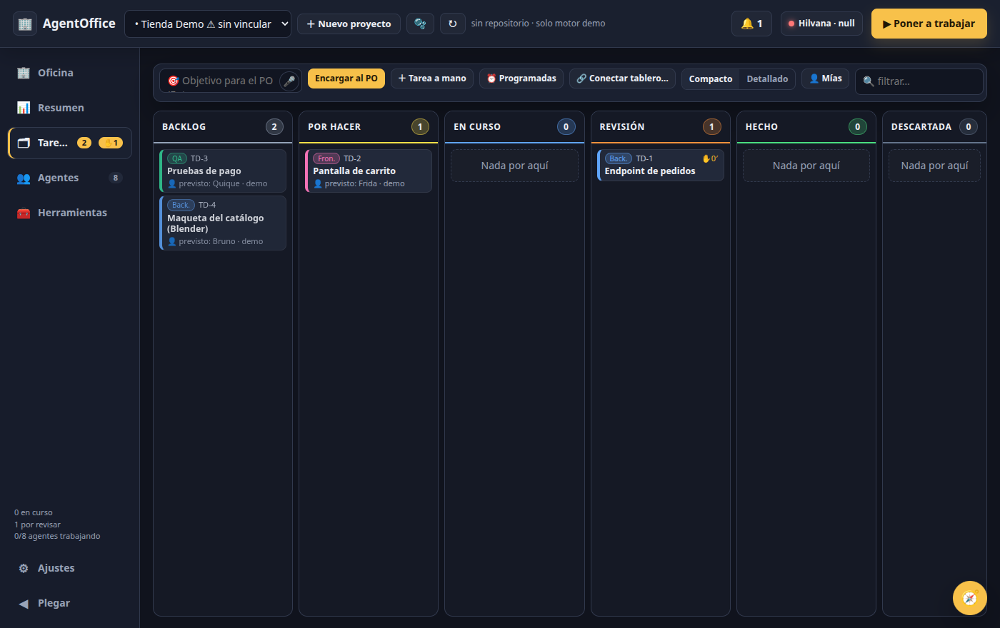

El **tablero** tiene seis columnas: *Backlog · Por hacer · En curso · Revisión · Hecho · Descartada*. Cada tarjeta lleva código (`TD-1`), rol, agente previsto/asignado y estado. Arriba:

| Control | Qué hace |
|---|---|
| 🎯 **Objetivo para el PO** + **Encargar al PO** | Escribes (o dictas con 🎤) *qué* quieres; el PO (product owner) decide quién lo hace y **crea la tarea** — es la «creación con IA» de alto nivel. Enter encarga, Shift+Enter salta de línea |
| **＋ Tarea a mano** | Abre «Nueva tarea» (abajo) |
| **⏰ Programadas** | Plantillas de tareas automáticas (abajo) |
| **🔗 Conectar tablero…** | Enlaza GitHub, Trello o Jira (Ajustes ▸ Tablero online) |
| **Compacto / Detallado** | Densidad de las tarjetas |
| **👤 Mías** | Solo las asignadas a «Yo (humano)» |
| **🗄 Archivadas** | Muestra Hechas y Descartadas archivadas (no se borran nunca) |
| **🔍 filtrar…** | Filtro de texto |

Arrastrar una tarjeta de columna cambia su estado; el menú **⋯** de la tarjeta (y la ficha) permite editar, mover a otro proyecto (⇄, solo si no ha empezado), devolver, descartar…

### Nueva tarea: crear con IA, adjuntos y modos de desarrollo

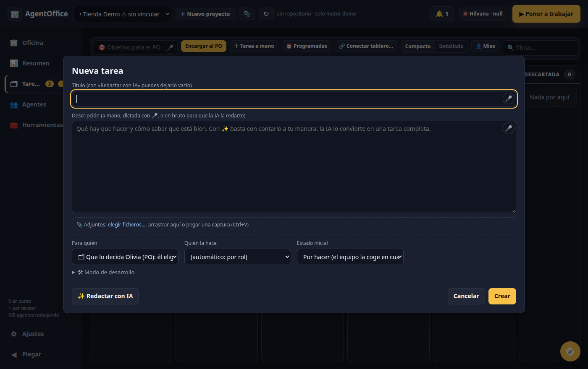

- **Título** y **Descripción** (a mano, dictada con 🎤 o en bruto). **Para quién** (un rol, o **«PO»** para que reparta el trabajo), **Repositorio** (si el proyecto tiene varios), **Quién la hace** (automático por rol, un agente concreto o **👤 Yo**) y **Estado inicial** (Por hacer o Backlog).
- **✨ Redactar con IA**: pasa tu texto y los adjuntos por la IA (Claude), que propone título, descripción con criterios de «hecho cuando», rol y repo y **rellena el formulario** para que lo revises antes de crear. Puedes dejar el título vacío.
- **Adjuntos**: pegar o arrastrar ficheros e imágenes sobre el formulario. Las imágenes viajan como capturas de la tarea y los demás ficheros como archivos de apoyo. En el móvil los botones son **📷 cámara · 🖼 galería · 📎 fichero** (ver [Móvil](#móvil)).
- **🛠 Modo de desarrollo** (desplegable al final):

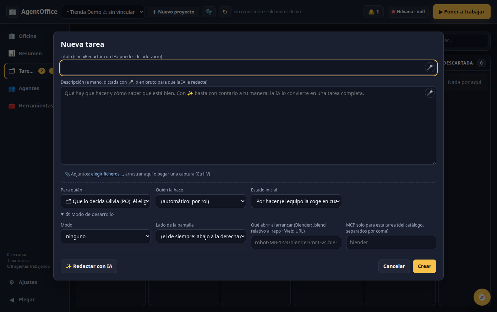

| Modo | Qué hace | Opciones |
|---|---|---|
| *(ninguno)* | Tarea normal | — |
| **web** | Abre la URL que el agente está construyendo en tu navegador y le pone su burbuja-chat | lado de la pantalla (izquierda/derecha), URL |
| **blender** | Abre Blender en su mitad de la pantalla con **4 vistas** (perspectiva, trasera, lateral, planta) y lo recarga y encuadra solo cada vez que el agente guarda el `.blend` | lado, fichero `.blend` (ruta relativa al repo), ejecutable en Ajustes ▸ «🧊 Ejecutable de Blender» |

### Programadas, comprobación sin IA y webhook

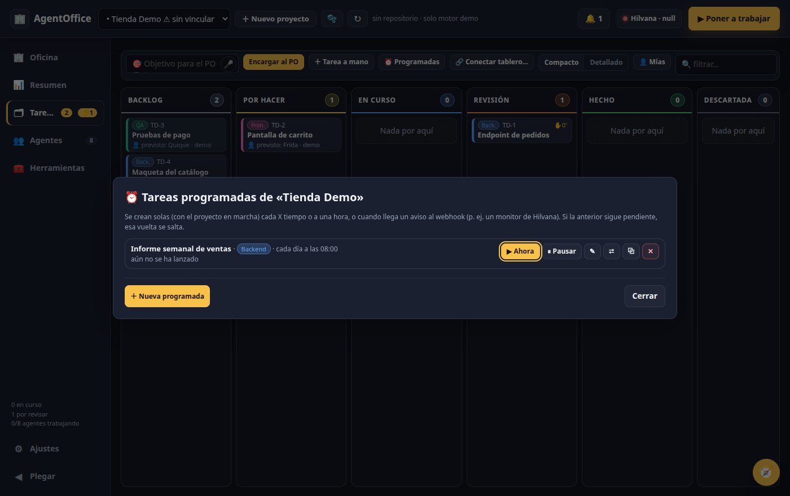

Por proyecto: una **plantilla de tarea** (título, descripción, rol, revisión obligatoria) que se crea sola **cada N minutos**, **cada día a una hora** o **cuando llega un aviso**. Opciones:

- **🔎 Comprobación sin IA**: una orden que corre en la carpeta del proyecto; código 0 = sin novedad (solo se apunta), **2 = crea la tarea** con la salida como datos, otro = error apuntado. Vigila sin gastar tokens.
- **🪝 Webhook** `POST /api/hooks/<token>` crea la tarea con el cuerpo del aviso (p. ej. el `notifyUrl` de un monitor de Hilvana). El token de la URL es la credencial.
- Botones por programada: ▶ ejecutar ahora, ✎ editar, pausar, ⇄ mover y ⧉ copiar a otro proyecto (la copia queda pausada y sin webhook). Si la tarea anterior sigue pendiente, esa vuelta se salta.

## Revisión: aprobar, devolver y «Llevar a mi checkout»

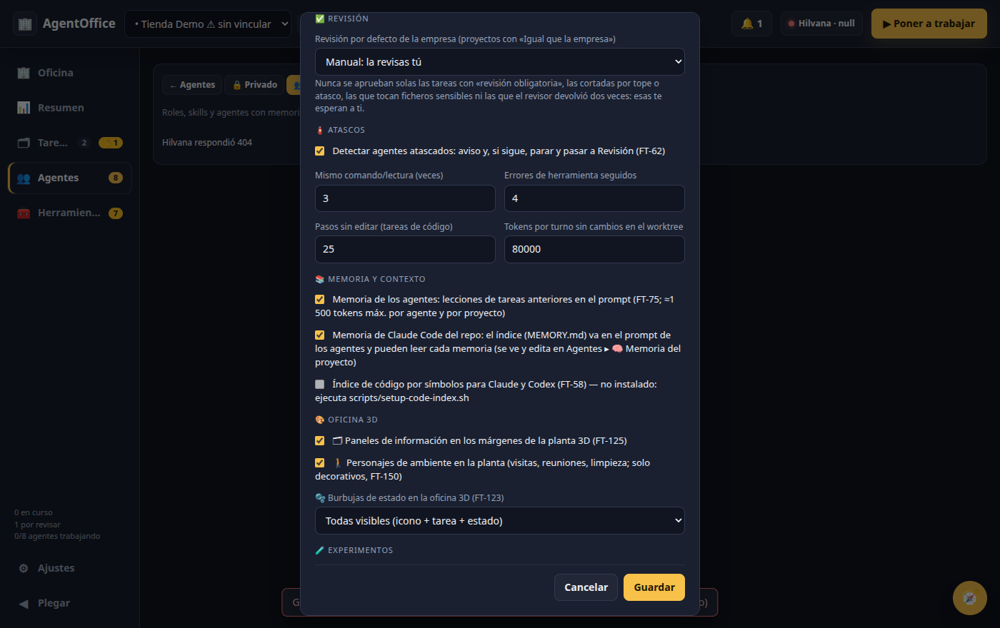

Al terminar, el agente deja la tarea en **Revisión** (columna naranja, chip **🔔 Para ti**, campana y avisos). Al abrir la ficha ves qué había que hacer, el resumen del agente y los botones:

| Botón | Efecto |
|---|---|
| **✓ Aprobar** | Fusiona la rama `ao/<código>` en la base (o, con «entregar sin commitear», solo cambia el estado). Si tu checkout tiene cambios locales los aparta con `git stash -u`, fusiona y los restaura |
| **↩ Devolver** | Le mandas lo que falta (texto, capturas, bocetos) y la tarea **vuelve a arrancar en su misma copia**; sube un peldaño la escalera de modelos |
| **Ver cambios** | Diff por repo y fichero, con ficheros nuevos |
| **✎ Editar** | Cambia título, descripción, rol, dependencias y modo de desarrollo |
| **📥 Llevar a mi checkout** | Aplica los cambios al checkout principal **sin commitear y sin mover HEAD** para verlos en tu IDE. Todo o nada: si tu checkout no está en la rama base o hay cambios en los mismos ficheros, no toca nada y te dice por qué |

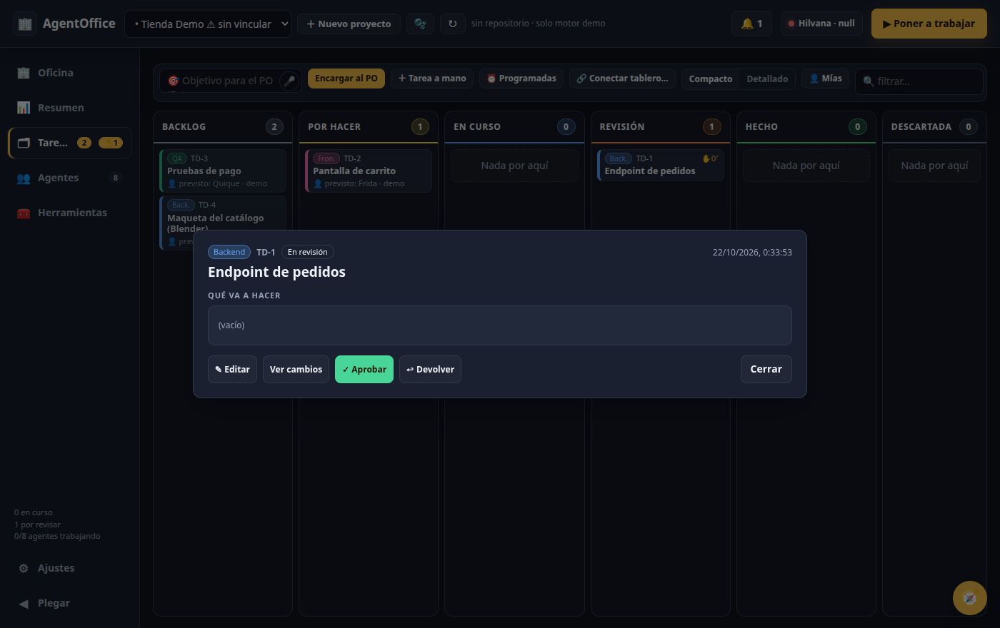

**Política de revisión** (Ajustes ▸ ✅ Revisión y por proyecto): *Manual* (la revisas tú), *Auto-QA* (aprueba sola si el QA da el visto bueno) o *Auto*. Nunca se aprueban solas las tareas con «revisión obligatoria», cortadas por tope o atasco, que toquen ficheros sensibles o que el revisor haya devuelto dos veces.

## Agentes y roles

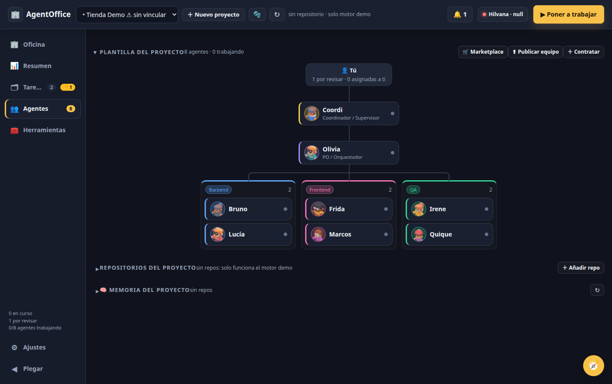

La pestaña **Agentes** es la plantilla del proyecto: cada agente con su **rol** (PO, Back, Front, QA, coordinador…), motor (Claude/Codex/demo), modelo, estado y sus tareas. Desde aquí:

- **Contratar** un agente nuevo (nombre, rol, motor, modelo) o sacar uno del **banquillo** (agentes de la empresa sin proyecto); **despedir**.
- Abrir el **cajón del agente**: tareas, memoria, costes, MCP/skills/scripts propios; **⇄ Proyecto…** mueve el agente a otro equipo y **⧉ Copiar…** crea otro igual.
- **Roles**: definen el prompt base, el motor y las herramientas por defecto. Se editan, se crean propios y se comparten en el Marketplace.
- Debajo: **repos** del proyecto (base de las tareas, tu rama actual, agentes en cada uno) y la **🧠 Memoria de Claude Code del repo**.
- El **coordinador** del equipo reasigna tareas según puntuaciones, y el **supervisor de serie** vigila las tareas encadenadas.

## Herramientas: skills, MCP y scripts

Pestaña **🧰 Herramientas**, con tres subpestañas. Un aviso (insignia roja) indica herramientas que un rol o agente declara y que no llegan.

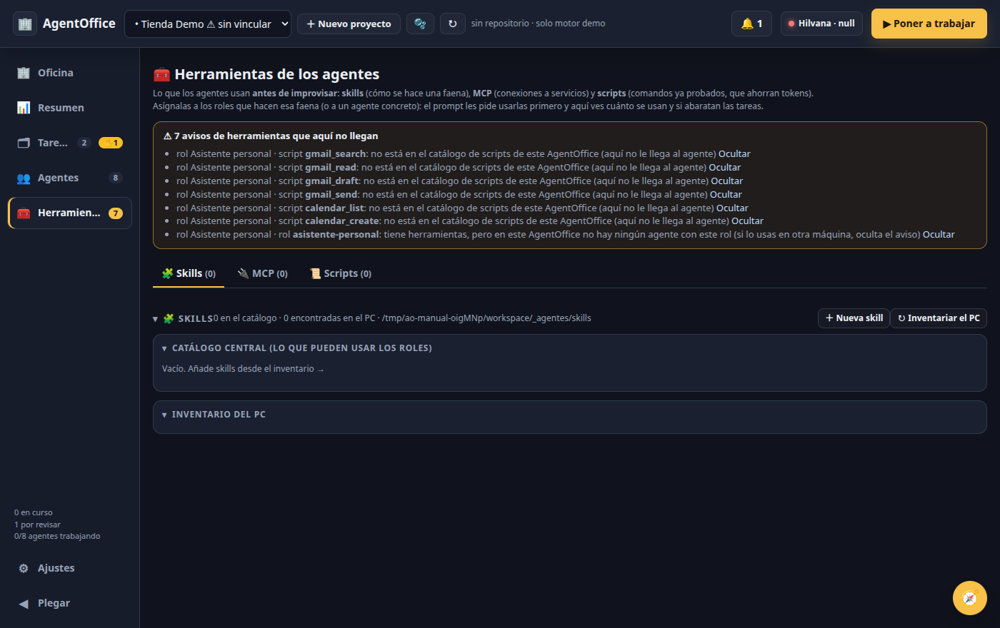

**🧩 Skills**: instrucciones reutilizables (ficheros `SKILL.md`) del catálogo (`<workspace>/_agentes`, o la carpeta fijada en Ajustes ▸ Conexión). Se asignan por rol o por agente y se publican en el Marketplace.

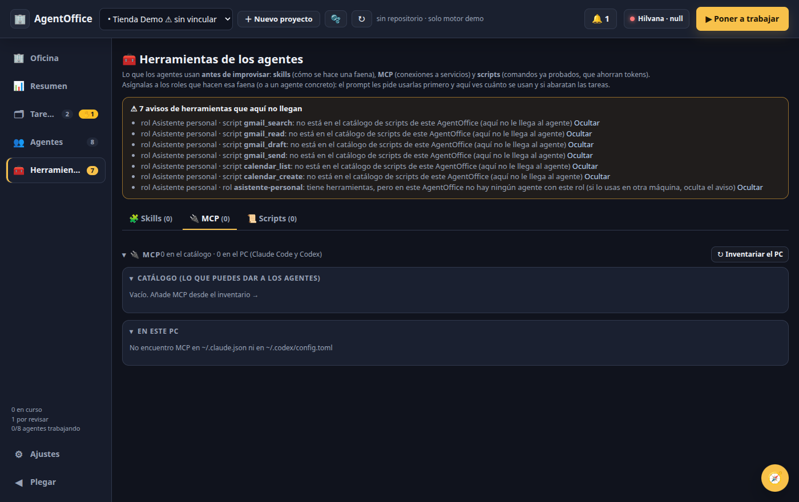

**🔌 MCP**: servidores MCP que los agentes pueden usar (navegador Playwright, Hilvana, bases de datos…). Se activan por rol/agente/tarea; el modo de desarrollo puede añadir los suyos.

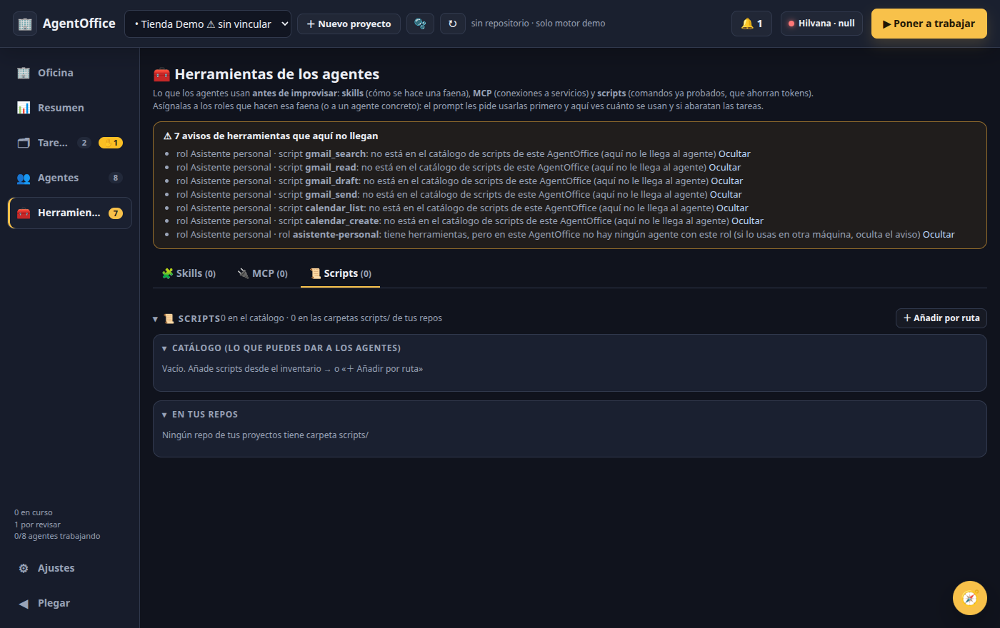

**📜 Scripts**: órdenes del equipo que el agente ejecuta tal cual (y que el sistema le anuncia en el prompt), en vez de improvisar comandos.

## Ajustes sección a sección

El botón **⚙ Ajustes** abre un formulario único agrupado en **Empresa**, **Proyecto**, **Guía y voz** y **Seguridad**. Suelto aparece como diálogo con una sola lista; **dentro de Hilvana** (Config ▸ Agentes, o Ctrl+,) ocupa casi toda la ventana con un **menú lateral por grupos** que filtra y recorre con ↑/↓.

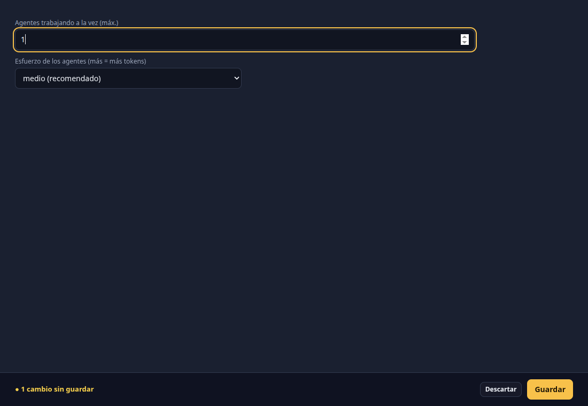

- **Barra Guardar siempre a la vista**: «Sin cambios» o «● N cambios sin guardar», con **Descartar** y **Guardar**; Guardar no cierra el panel.
- **Punto de cambios**: las secciones con cambios llevan un punto amarillo en el menú lateral. Si cierras (Esc, ✕, clic fuera) con cambios pendientes, pregunta antes. Un valor inválido en otra sección te lleva a ella y la marca.

### Grupo Empresa

| Sección | Captura | Para qué |
|---|---|---|
| 🧠 Motores de IA | 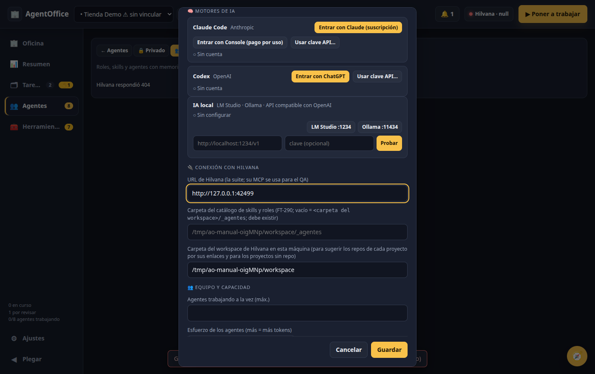 | Entrar con Claude (suscripción, Console o clave API), Codex (ChatGPT o clave) o una **IA local** (LM Studio/Ollama) |
| 🔌 Conexión con Hilvana | 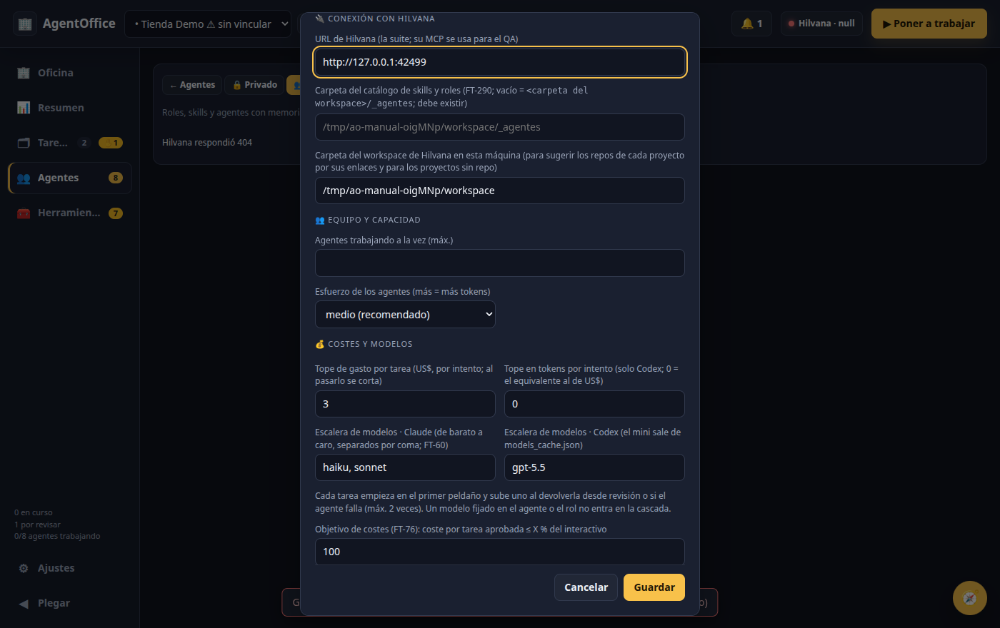 | URL de Hilvana, carpeta del **catálogo**, carpeta del workspace en esta máquina |
| 👥 Equipo y capacidad | 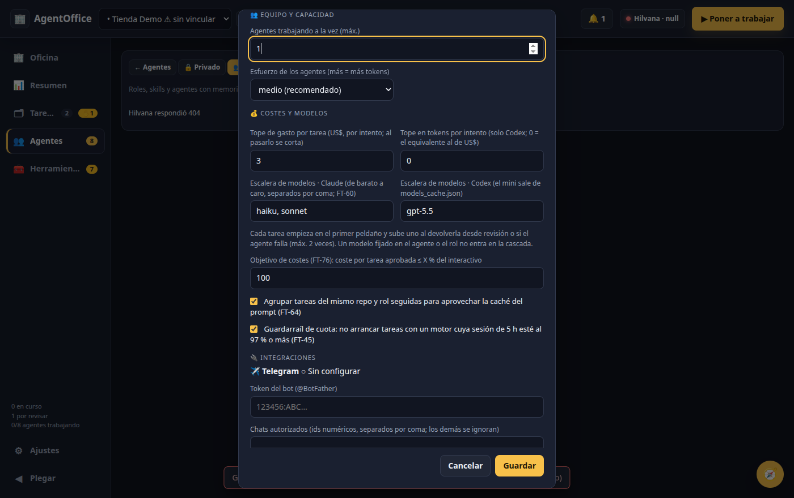 | Agentes a la vez (máx.) y esfuerzo de los agentes |
| 💰 Costes y modelos | 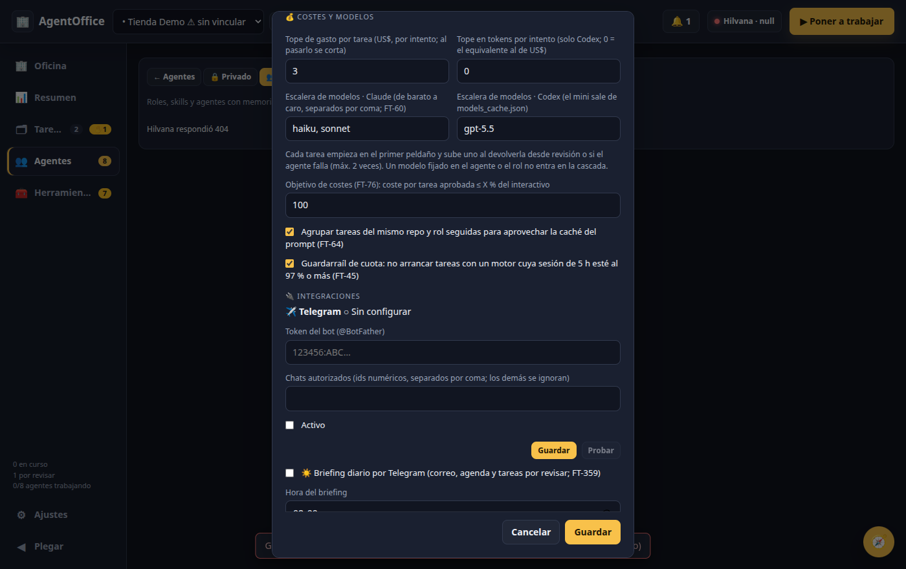 | Tope de gasto/tokens por tarea, **escalera de modelos** (de barato a caro, sube al devolver), objetivo de costes, agrupar por caché, guardarraíl de cuota |
| ✅ Revisión |  | Política por defecto: manual / auto-QA / auto |
| 🧯 Atascos | 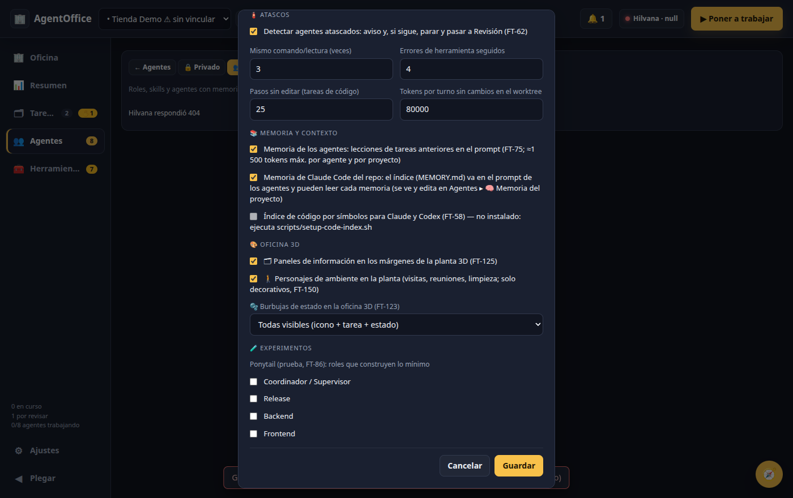 | Detecta agentes atascados (mismo comando, errores seguidos, pasos sin editar) y los pasa a Revisión |
| 📚 Memoria y contexto | 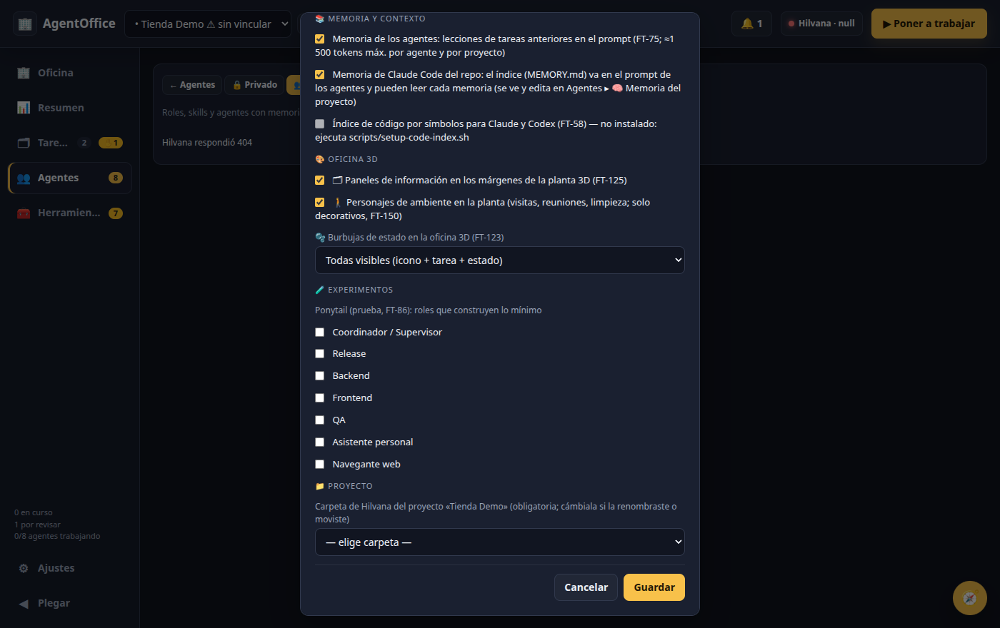 | Memoria de los agentes, memoria de Claude Code del repo, índice de código |
| 🎨 Oficina 3D |  | Paneles, personajes de ambiente y burbujas de la escena |
| 🧪 Experimentos | 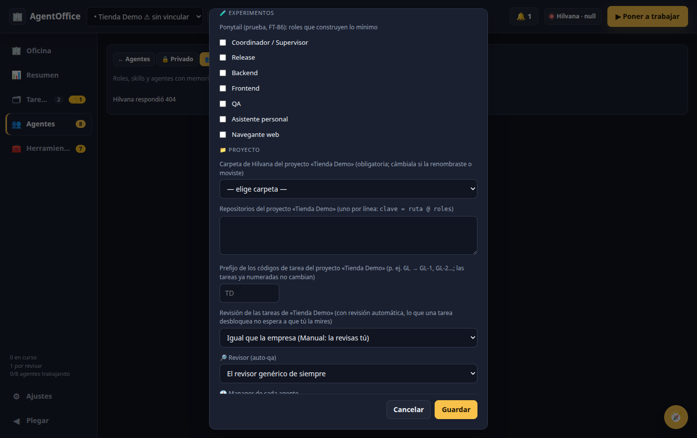 | «Ponytail»: reglas de «construir lo mínimo» por rol |

### Grupo Proyecto

| Sección | Captura | Para qué |
|---|---|---|
| 📁 Proyecto | 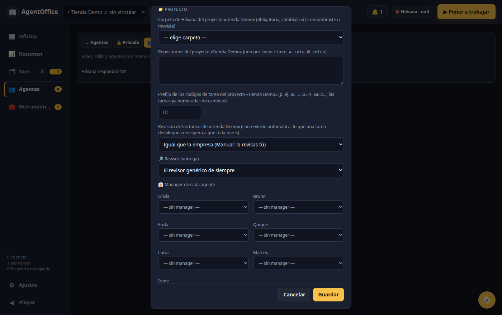 | Carpeta del workspace y repos, prefijo de códigos, coordinador, **📂 acceso a la carpeta del proyecto** y **📤 entregar sin commitear** (ambas desactivadas por defecto), revisión por proyecto |
| 🔗 Tablero online | 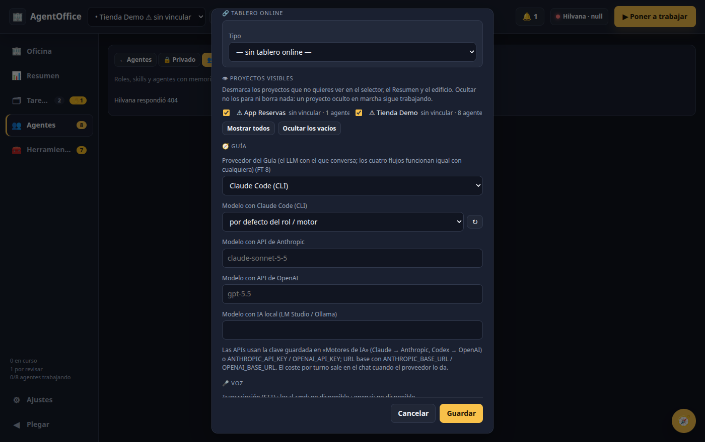 | GitHub, Trello o Jira |
| 👁 Proyectos visibles | 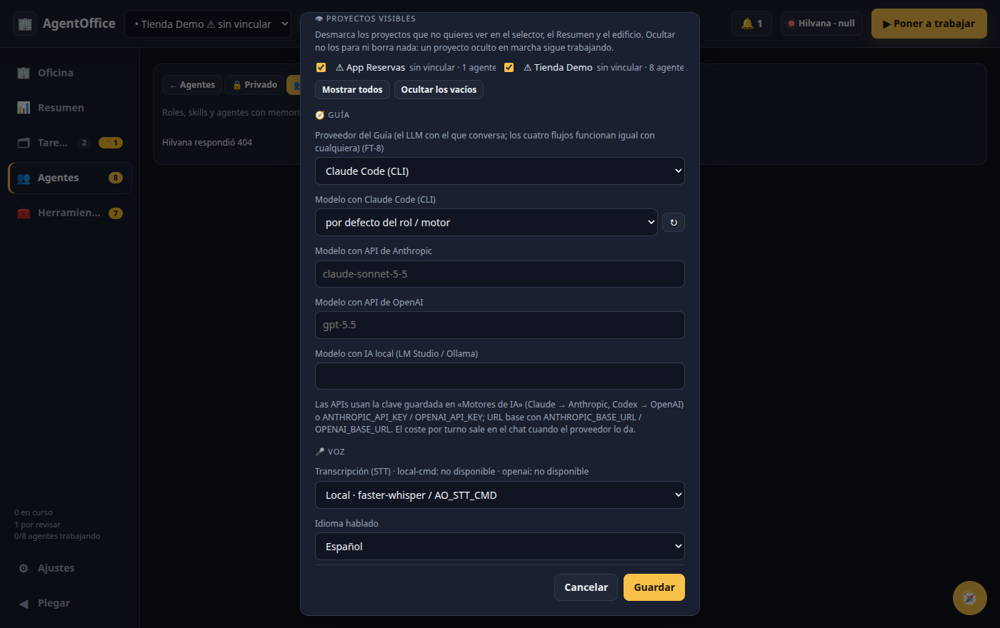 | Ocultar proyectos de la UI (ocultar no para nada: un proyecto oculto en marcha sigue trabajando) |

### Grupo Guía y voz

| Sección | Captura | Para qué |
|---|---|---|
| 🧭 Guía |  | Motor y modelo del Guía |
| 🎤 Voz | 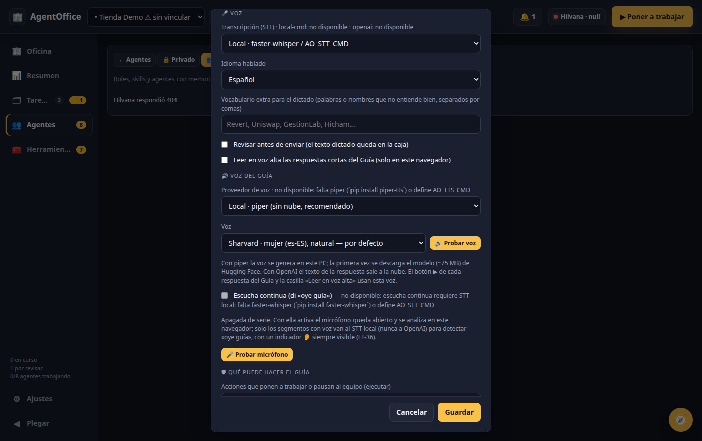 | Dictado: STT local o del navegador, **Probar micrófono** |
| 🔊 Voz del Guía | 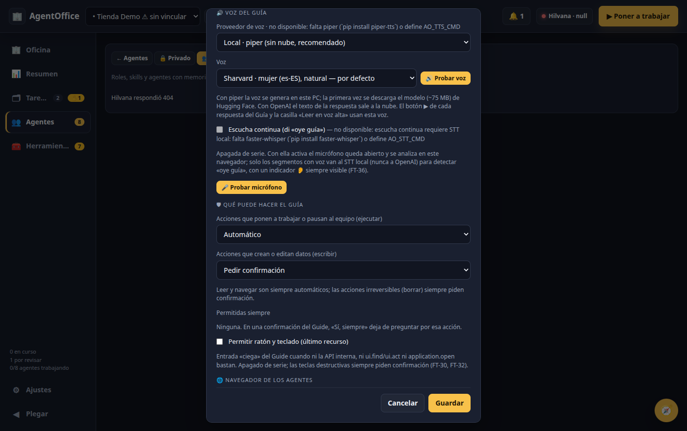 | Proveedor y voz de lectura, **Probar voz** |

### Grupo Seguridad

| Sección | Captura | Para qué |
|---|---|---|
| 🛡 Qué puede hacer el Guía |  | Acciones que el Guía hace sin preguntarte |
| 🌐 Navegador de los agentes | 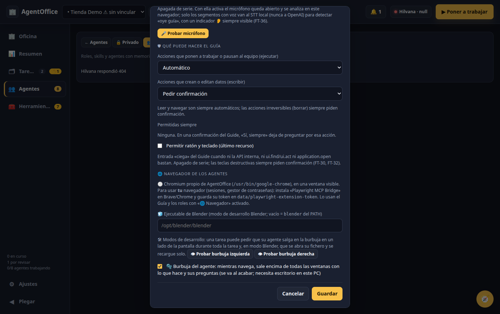 | Qué navegador usan los agentes (Playwright) y sus permisos |

## Burbuja del agente

Aparece junto al borde de la pantalla para los agentes que usan el navegador o trabajan en una tarea con **modo de desarrollo** (también hasta 12 h después de «hecha», para abrir una nueva ronda). Cabecera con el **nombre del proyecto**, el muñeco 3D del agente y la insignia de su motor (CLAUDE / CODEX).

- **Chat**: escribe (Enter envía) y pega o arrastra imágenes. Un agente Claude lo recibe **en caliente**; Codex lo recibe al relanzar la tarea (la burbuja lo avisa).
- **📸 Captura**: captura tu pantalla y la deja adjunta.
- **✏️ Boceto**: lienzo con lápiz, flecha, texto, goma y deshacer sobre la última imagen o en blanco; «Usar boceto» lo adjunta.
- **👍 Aprobar / ↩ Devolver**: cuando el agente termina muestra su resumen y estos dos botones, con las mismas reglas que la revisión del tablero.
- **Nueva ronda**: tras «hecha» la burbuja sigue 12 h; si le escribes abre una tarea nueva en el mismo hilo.
- **Plegar ▾**: queda solo el muñeco y se despliega sola si pregunta, te escribe o termina. **✕** oculta esa burbuja hasta que tenga novedades; **🫧** en la barra superior (o en Ajustes) vuelve a mostrarlas y reabre los Blender.
- Con dos agentes, cada uno en un lado de la pantalla.

## El recuerdo de cada agente: Conversaciones, Burbuja y «Que siga con…»

Cada agente conserva **su recuerdo**: todo lo hablado con él por la burbuja, tarea a tarea, se guarda y sobrevive a las tareas y a los reinicios. Lo ves de dos formas:

- **En la burbuja:** el hilo ya no es el de la tarea, sino el historial del agente, con un separador por tarea («— Tarea 21 —»). Al abrir una ronda nueva no empieza vacío.
- **En su ficha (Equipo ▸ tarjeta del agente ▸ 💬 Conversaciones):** el historial completo, con las imágenes que le mandaste, y un bloque **▶ Que siga con…**: eliges una de sus tareas anteriores (de cualquier proyecto), escribes qué quieres que haga a partir de ella y pulsas **Encargarle**. Se crea una tarea nueva para ese agente enlazada con la elegida, con su misma carpeta, modo de desarrollo y lado de pantalla, y su burbuja aparece al arrancar. Sirve para retomar algo meses después partiendo de lo que ya hizo y de lo hablado.
- **🫧 Burbuja** (en la misma tarjeta): abre su burbuja en pantalla aunque ahora no tenga tarea en curso, con su última tarea y su historial.

### Una sesión viva por agente

Antes, cada tarea abría una conversación nueva con el modelo y el agente volvía a leer todo el contexto. Ahora cada agente mantiene **una sesión viva**: su siguiente tarea retoma la misma conversación (mismo motor y modelo) con un encargo corto, así que recuerda lo anterior y el arranque cuesta mucho menos. La ficha del agente muestra la sesión (desde cuándo, cuántas tareas, tokens) y permite **reiniciarla**; en Ajustes se puede desactivar. Cuando la conversación crece demasiado, AgentOffice le pide las notas, las guarda en su memoria y abre una sesión limpia en la siguiente tarea. Codex no retoma sesiones: arranca con su memoria de agente.

### Un Blender por lado

En modo Blender, al arrancar una tarea nueva en un lado se cierra el Blender de la tarea anterior de ese lado y se abre el de la nueva, así nunca se apilan ventanas. Los entornos de prueba y de demo de AgentOffice no abren nada en tu escritorio.

## Telegram

AgentOffice puede hablar contigo por Telegram: te escribe los avisos y las preguntas del equipo, y tú le escribes para hablar con la Guía o lanzar comandos. Es opcional y se configura en **Ajustes ▸ 🔌 Integraciones**, con **tu propio** bot: nada pasa por servidores de terceros. **Sin captura**: la tarjeta pide un token real.

### Qué hace

- **Avisos y preguntas:** el bot te manda las preguntas de los agentes y las confirmaciones 🛡 con botones; pulsar uno contesta a la tarea, y responder al mensaje vale como respuesta escrita.
- **Hablar con la Guía:** cualquier texto que escribas al bot va a la Guía, con las mismas herramientas y confirmaciones que su chat en la aplicación.
- **☀️ Briefing diario:** a la hora que elijas recibes en Telegram las tareas que esperan tu revisión.

### Configurar Telegram paso a paso

1. En Telegram abre **@BotFather**, envía `/newbot`, elige nombre y usuario y copia el **token**.
2. Averigua tu **chat id** numérico (por ejemplo escribiendo a un bot como @userinfobot) y escribe un mensaje a tu bot para que pueda contestarte.
3. Ajustes ▸ 🔌 Integraciones ▸ tarjeta **Telegram**: pega el token, escribe tu chat id en **Chats autorizados**, marca **Activo** y **Guardar**; **Probar** envía un mensaje de comprobación.
4. Con la escucha en marcha aparece el chip **✈️** en la cabecera; al pulsarlo se abre esta tarjeta.

Solo se atienden los chats autorizados. El resto se ignora y queda anotado en la auditoría.

### Comandos y botones

| Comando | Qué hace |
|---|---|
| `/tarea <texto>` | Crea una tarea en el proyecto por defecto (o en el primero) para el rol de producto |
| `/parar` | Corta la conversación en curso con la Guía y detiene a los agentes que estén trabajando |
| `/ayuda` | Lista los comandos |

### Seguridad

- El token del bot se guarda en la carpeta de datos de AgentOffice, **no en el repositorio**. La pantalla y la API lo muestran enmascarado (`abc…xyz`): guardar el valor enmascarado o dejarlo vacío conserva el real.
- Límite de 20 mensajes por minuto y chat.
- **📋 Auditoría de acciones**: quién pidió cada acción, quién la confirmó y los chats ignorados.
- Para dejar de usar la integración: desmarcar **Activo**.

La conexión con el correo y la agenda de Google llegará en una versión próxima.

## Guía y Marketplace

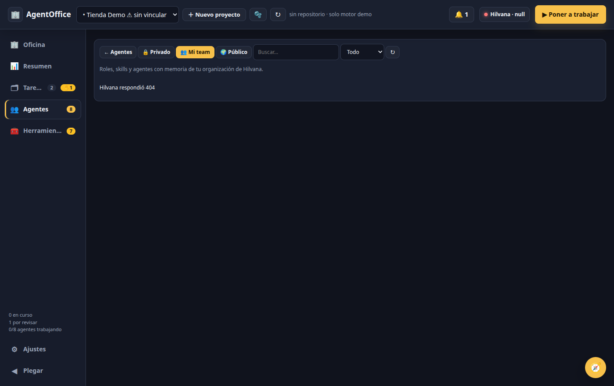

El **🛒 Marketplace** (botón dentro de Agentes) comparte **roles, skills y agentes** con tu organización o en público (con moderación) e instala los de otros. Pestañas: **Agentes · 🔒 Privado** (tu banquillo y tus roles) y las de la nube. *(En la captura sale un 404 porque el entorno de demo usa una instalación simulada de Hilvana sin cuenta vinculada: con la cuenta vinculada se ven los listados.)*

## ＋ Nuevo proyecto

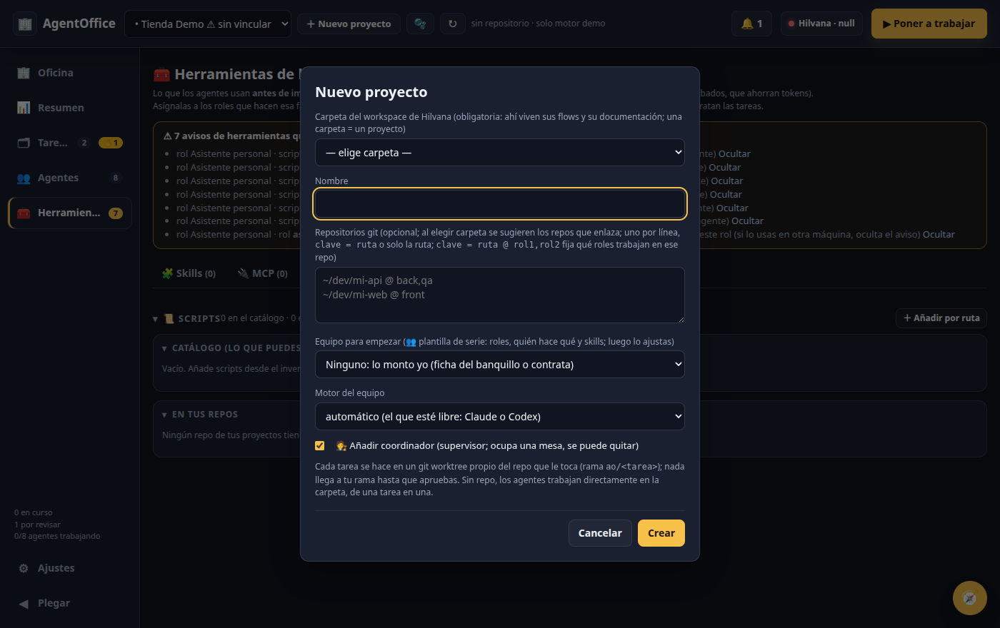

Un proyecto de AgentOffice es una **carpeta del workspace de Hilvana** (donde viven sus flows y su documentación). El diálogo pide el nombre, la carpeta (existente o nueva) y los **repos** (rutas git que el equipo modifica; puede haber varios y cada tarea trabaja en su propio worktree por repo). También se admiten **proyectos sin repo**: solo carpeta. ↻ comprueba que las carpetas siguen existiendo.

## Móvil

`/agents/m.html` (y la app Android) es otra página, pensada para el pulgar: cabecera con proyecto, **▶/⏸**, indicador de conexión y enlace «Web», y cuatro pestañas abajo.

| Pestaña | Captura | Qué hay |
|---|---|---|
| 📊 Resumen | 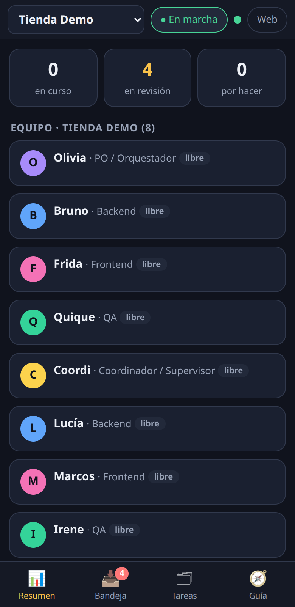 | Estado de la empresa y **Equipo** del proyecto |
| 📥 Bandeja | 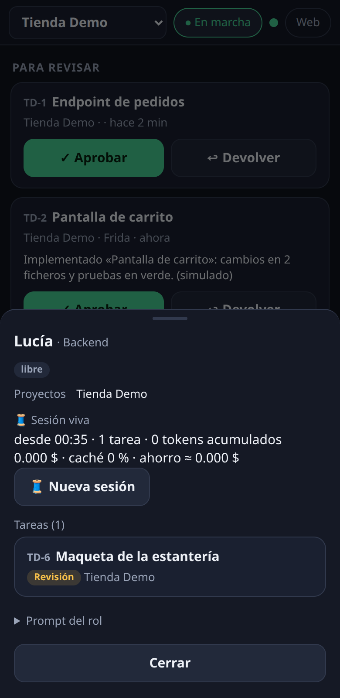 | «Para ti»: revisiones, preguntas y avisos (insignia con el número) |
| 🗂 Tareas | 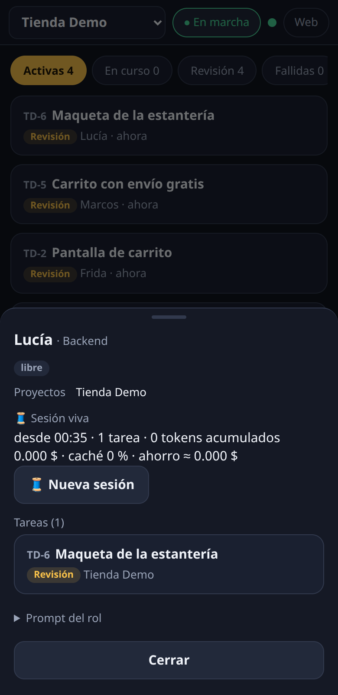 | Filtros, tarjetas y **＋ Nueva tarea** |
| 🧭 Guía | 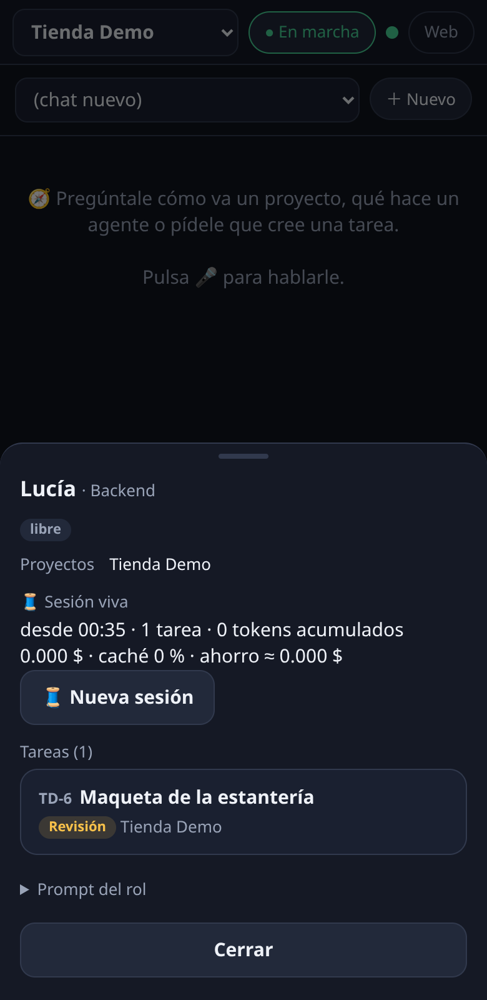 | Chat con la Guía: chats, ＋ Nuevo, 🎤 dictar |

**Hoja de Equipo**: tocar a una persona del Equipo abre su ficha (rol, motor, tarea actual, memoria…; lo que no tenga se oculta).

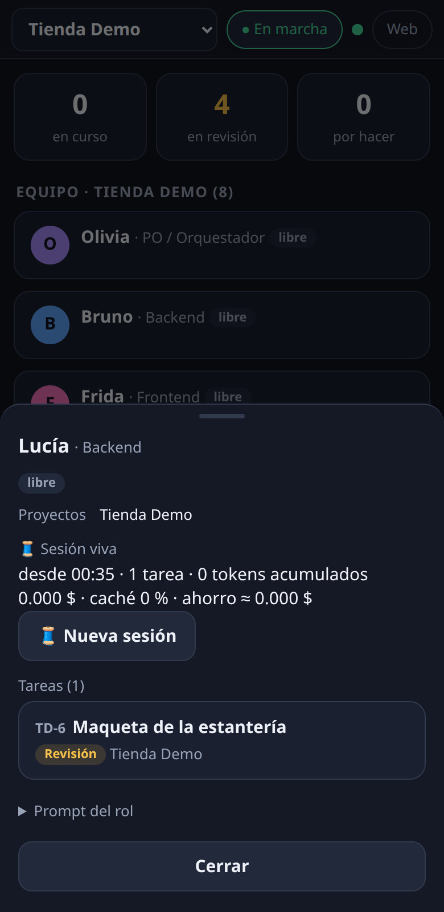

**＋ Nueva tarea** con adjuntos **📷 cámara · 🖼 galería · 📎 fichero** (se suben al elegirlos) y dictado:

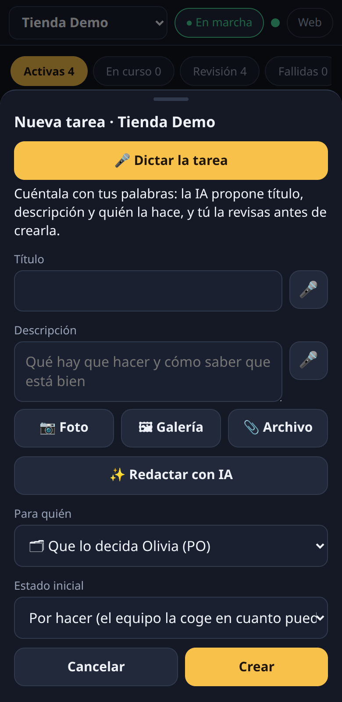

